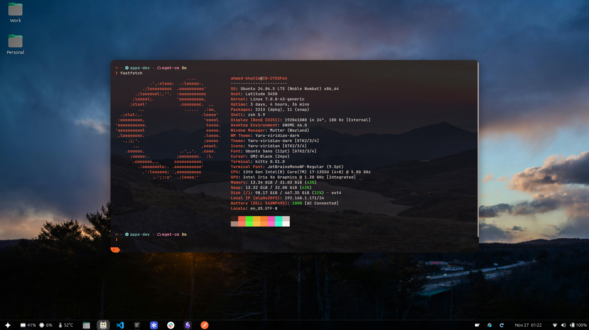
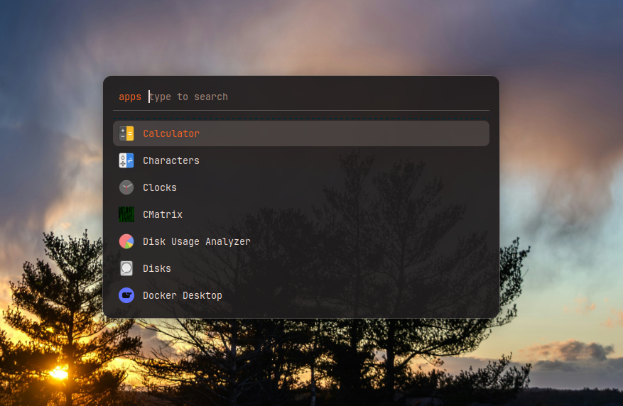
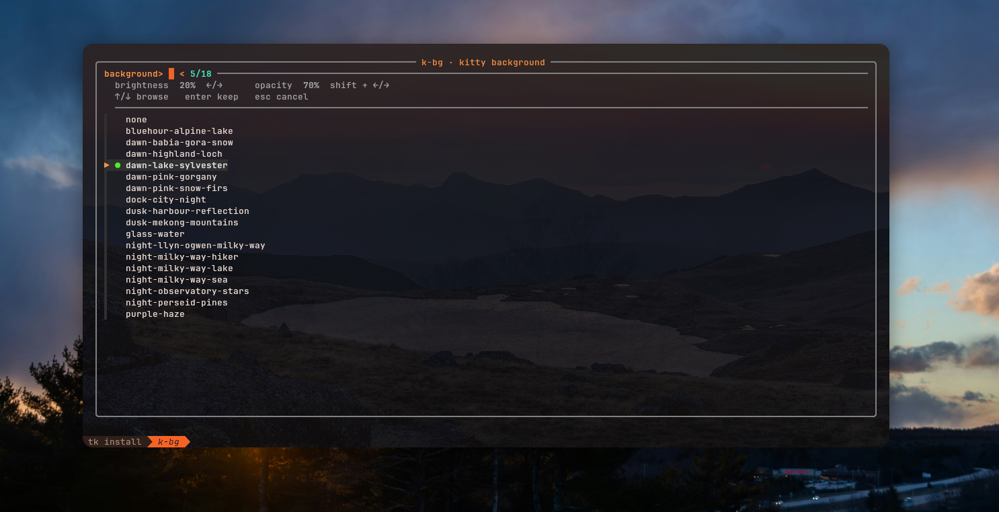
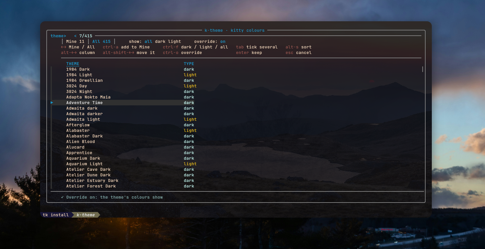

# bluefeels

A look for [unikit](https://github.com/bluestero/unikit)'s `fk`: the kitty terminal, the shell (starship, zsh, keys, btop, yazi), the GNOME desktop (rofi launcher, app keys, extensions) and Claude's coding guidelines.

<!-- The paragraph above is what `uk layers` shows on its about card: keep it plain text, first under the title. -->



<br>

## Why you'll like it

- 🖼️ **Your background sets the colours.** Pick a background and the prompt, pickers, cursor and selection take a colour from it, always readable.
- 🎨 **400+ themes, previewed live.** Your short list plus every kitty theme, and rofi and btop follow along.
- 🚀 **One launcher for everything.** Windows, apps, ssh, speaker, mic, wifi, Bluetooth and power, all from the keyboard.

  

- ⌨️ **Super+1..9 opens your dock apps.** Launch, bring to front, or minimize: one key.
- 🐚 **bash and zsh feel the same.** One prompt, the same aliases and keys, with suggestions from your history in zsh.
- 🧱 **A calmer GNOME.** One bar or a dock, system readings in the top bar, blur, rounded corners.
- ↩️ **Your old setup comes back.** Uninstall puts back your settings, and `fk configs` switches any app between the preset, its default and yours.

<br>

## Get it

You need [unikit](https://github.com/bluestero/unikit#get-it) first. Then:

```bash
uk layer add bluefeels     # shows what runs here, asks, then offers to set up its parts
```

Or tick it on unikit's first run (`install.sh` offers it), then `fk install`. Its parts are `fk`'s,
so `fk install` sets them up any time, never `tk install`. Nothing is ticked until you tick it.

<br>

## What you get

| | |
|---|---|
| **kitty** | the latest kitty, its config, new windows centered, extra app icons |
| **the shell** | starship prompt, zsh with suggestions, Tab and history keys, btop, yazi (`y`), your old `~/.bashrc` tidied |
| **the desktop** | rofi launcher, Super+1..9 app keys, Alt+Tab after Show Desktop, Docker's tray dots hidden |
| **GNOME looks** | Dash to Panel *or* Dash2Dock, Vitals (+ chip icons), Blur my Shell, rounded corners, no window animations |
| **Claude** | coding guidelines and skills as plugins, picked per profile in `uk skills` |

**Commands**

| Command | What it does |
|---|---|
| `k-bg` | background picker: live preview, brightness, opacity, accent colours from the image |
| `k-theme` | colour themes with live preview: your short list plus kitty's 400+ |
| `k-icon` | pick kitty's app icon |
| `k-config` | edit kitty's config; kitty reloads it on save |
| `fk configs` | switch each app's preset: bluefeels', the app's default, or yours |

<details>
<summary><b>See <code>k-bg</code> and <code>k-theme</code></b></summary>
<br>





</details>

**Keys**

| Key | Opens |
|---|---|
| Alt+Space | open windows, then apps |
| Super+S | speaker, mic, wifi, Bluetooth |
| Super+X | power: lock, suspend, log out, restart, shut down |
| Super+1..9 | the Nth app in your dock |
| Ctrl+Alt+T | kitty (focuses the open window) |

Dash to Panel and Dash2Dock both sit on the bottom edge, so pick one: `fk install` asks once if both are ticked.

Every part in full, what uninstall puts back, the zsh setup and the folder layout: **[docs/parts.md](docs/parts.md)**.

<br>

## Build on it

| You want to | Read |
|---|---|
| change or add a part here | [docs/parts.md](docs/parts.md) |
| write a layer of your own | unikit's [docs/LAYERS.md](https://github.com/bluestero/unikit/blob/main/docs/LAYERS.md) |

## Licences

The background photos each have their own licence (some CC BY-SA, which means changed copies are
shared under the same licence): see [backgrounds/SOURCES.md](backgrounds/SOURCES.md).
